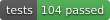

# 非遗动态手势展示系统（DSTE-Net）

       

> 徽章是 shields.io 的**本地副本**（`docs/badges/`），不直接引用远程 URL——
> 编辑器预览对远程内容有安全限制、或断网时会加载不出来。
> 改版本号后跑 `python tools/fetch_badges.py` 重新拉取即可。

基于 **DSTE-Net**（ResNet-50 + 时空激励模块）的实时动态手势识别桌面应用，用于文化馆非遗展陈：
观众无需接触设备，用手势即可浏览非遗项目、播放介绍视频、查看 3D 展品。

- **界面**：PySide6（含 QtWebEngine 展示 3D）
- **识别**：两路模型并行 —— **DSTE-Net**（IPN-Hand 13 类，8 帧 RGB，认"手的动作"）
  与 **ResNet18**（HaGRID 34 类，单帧，认"手的形状"，只负责 OK / 比耶两个手势）
- **交互**：手势驱动页面导航 + 视频快进快退 + 3D 模型旋转缩放
- **性能**：**纯 CPU**。动态模型约 0.58s/次、静态模型约 15ms/次（可忽略）

---

## 目录

| | |
|---|---|
| [一、功能特性](#一功能特性) | 页面 · 手势映射 · 防误触发 |
| [二、快速开始](#二快速开始) | 环境 · 运行 · 资源要求 |
| [三、目录结构](#三目录结构) | |
| [四、素材与生成脚本](#四素材与生成脚本) | 图片 / 模型 / 视频的来源与再生产 |
| [五、模型说明](#五模型说明) | 网络结构 · 权重来源 · 实测耗时 |
| [六、运行机制与调参](#六运行机制与调参) | 防重复触发 · 空闲降频 · 交互区 · 参数速查 |
| [七、测试](#七测试) | |
| [八、打包](#八打包) | PyInstaller 目录版 · 安装 / 卸载脚本 |
| [九、已知限制与待办](#九已知限制与待办) | |
| [十、参考](#十参考) | |

---

## 一、功能特性

### 页面

| 页面 | 内容 |
|---|---|
| 首页 | **两排卡片**：第一排非遗项目、第二排非遗传承人；选中高亮 + 光条，右上角**点赞角标**，水墨粒子背景 |
| 详情页·主视图 | 作品图**自动轮播**（3.5s，带页码）+ **项目信息卡**（类别/传承人/详实简介）+ 三个功能按钮 |
| 详情页·非遗详情 | 项目介绍（可滚动）+ **介绍视频**（循环播放、可手势快进快退）+ 3 张配图 + **项目二维码**（扫码了解）|
| 3D 交互展示 | three.js(r147) 加载 GLB 模型，自动居中/适配、自转，扁平模型自动侧倾 |
| 传承人风采 | 传承人视频/照片，上下切换；左/右可快进快退视频 |
| 设置/说明 | 三标签页：手势对照表（动态一张、静态一张，按真实映射维护）/ 参数调节（现场调参滑条）/ 图片来源 |

### 手势交互（按页面）

| 页面 | 手势 | 动作 |
|---|---|---|
| 首页 | 向左 / 向右抛出 | 上一项 / 下一项（在**全部卡片**的扁平顺序上走，首尾环绕）|
| 首页 | 向上 / 向下抛出 | 上一排 / 下一排（跨排换列；对位不存在就不动）|
| 首页 | 单击 | 进入选中项：项目卡 → 详情页，传承人卡 → 传承人页**那一位** |
| 详情页·主视图 | 向左 / 向右抛出 | 切换选中按钮（返回主页 / 非遗详情 / 交互展示）|
| 详情页·主视图 | 单击 | 确认（激活选中按钮）|
| 详情页·非遗详情 | 向左 / 向右抛出 | 视频**快退 / 快进 30 秒** |
| 详情页·非遗详情 | 单击 | 返回主视图 |
| 3D 展示 | 张开两次 / 缩小 / 双指指向 / 双指双击 | 放大 / 缩小 / 旋转模型 |
| 3D 展示 | 单击 | 返回 |
| 传承人页 | 向左 / 向右抛出 | 视频快退 / 快进 30 秒 |
| 传承人页 | 向上 / 向下抛出 | 上一位 / 下一位传承人 |
| 传承人页 | 单击 | 返回 |

> 模型共 13 类，映射见 `src/core/gesture_mapper.py`。**未绑定的类别**：单指指向、双击、
> 双指点击、放大 —— 理由分三类，都是实测结论：
> 双击 (0.577) 本身识别就弱；单指指向准确率虽高 (0.973)，但"人在镜头前走路"时被误认
> **24.1%**（是走路最易被认成的类），且"指着屏幕"本就是访客的自然动作；
> 双指点击 (0.750) 属"点击族"，与单击只差手指数量、易互混。
>
> **「旋转模型」刻意同时接了双指指向与双指双击两个类** —— 这是刻意的合并，不是笔误：
> 模型对这两个"双指"类分不太开（现场实测：慢速的双指指向常被认成双指双击），
> 而两者访客意图相同、动作也一样，合并后那类误判就不会产生错误后果。
> **G02 双指点击不并入**：意图不同，且走路时有 13.8% 被误认成它。
>
> 设置页的手势对照表按各页真实分发逻辑维护，改映射时需同步（真值来源是
> `main_window.MainWindow._ocg`）。

### 静态手势（按手的形状，**不跟页面走**）

上面那张表认的是"手**刚才做了什么动作**"，靠的是 DSTE-Net 时序模型。
另外还有一路**静态手势**（HaGRID 34 类 ResNet18），认的是"手**此刻是什么形状**"，
情况只有两个：

| 手势 | 动作 |
|---|---|
| **OK 手势** | **返回首页**（任何页面上都生效）|
| **比耶**（✌️）| **进入手势说明页**（**3D 展示页除外**，见下）|
| **点赞**（👍）| **给当前这个非遗项目 / 传承人点赞 +1**（首页卡片右上角会显示累计数）|

> **点赞是给"东西"点的，不是给系统点的**：数按非遗项目 / 传承人**分开记**，
> 挂在首页对应卡片右上角（`♥ N`）。访客一眼能看出哪个展项最受欢迎，
> 文化馆也顺带拿到一份真实的使用分布。没有赞的卡片不显示角标。
>
> 在首页上就是给**当前选中的那张卡**点赞（第一排项目、第二排传承人各记各的）；
> 详情页 / 3D 页给当前项目；传承人页给当前那一位。**设置页上没有可点赞的对象**，
> 在那里做这个手势不响应（也不会白白吃掉一次冷却）。
>
> 数据存在 `likes.json`（铺在 exe 旁边、**不进版本库**），换展台时它跟着走。
> 存档读坏了会自动当空的重来，不会让程序起不来。

> 两个模型吃的是**同一块画面**（画面中央的手势交互区），所以同一个手型会**同时**
> 喂进两边。只要静态类的手型撞上某个在用的动态手势，两边的判断就会被同一只手
> 同时点燃、产生两个互相矛盾的意图：
>
> | 静态类 | 手型 | 撞上哪个在用的动态手势 |
> |---|---|---|
> | `palm` / `stop` | 五指张开 | 张开两次（→ 放大）|
> | `fist` | 握拳 | 缩小 |
> | `point` / `one` | 伸食指 | 单指指向、单击的手型 |
> | `peace` / `two_up` | 两指 | 双指指向、双指双击（→ 旋转模型）|
>
> **OK 完全不冲突**。**比耶撞车，但只在 3D 页撞** —— 它撞的那个「旋转模型」
> 只在 3D 页上有意义，别的页面上动态模型就算把两指认成"双指指向"，也没有任何动作
> 会响应。所以：**3D 页把 ✌️ 让给动态模型**（那一页的两指是"旋转模型"），
> 其余页面上 ✌️ 才是"进手势说明页"。这样一只手不会同时干两件事。
>
> 其余 32 类**一律弃权** —— 模型判成它们时**不产生任何后果**，动态模型完全不受影响。
> 模型里还有 `middle_finger` / `dislike` / `three_gun` 三类，**有意不绑**
> （展台上误触发会很难看，且对访客毫无操作意义）；比心（`hand_heart`）需要**两只手**，
> 展台上不可行。`two_up` 虽然也是两指，但撞的是同一个动态手势且没有 3D 页那条豁免，
> **不绑**。
>
> ⚠️ **门槛是现场试出来的、没正式标定**（一天内改过三轮）：静态门槛 0.8、需连续两帧，
> 见[第六节](#六现场调参)。现场发现乱触发就往高调、发现比不出来就往低放 ——
> **但别定在模型实际输出分布之上**（实测 top1 稳定后常只有 50~60%），
> 否则会变成"手势做对了也不触发"。

### 防重复触发机制

慢模型（单次推理约 0.6s）下要保证"不重复触发"，靠的是**两道，都很短**的机制：

- **显示与触发分离**：显示用即时结果（跟手），触发用平滑结果（稳定）
- **冷却**：从**触发**那一刻起算，1.5 秒内不再响应
- **间隙**：触发条件必须**先不成立一次**，下一次才算数 ——
  同一个手势一直被识别时，触发条件始终成立，间隙永远不来，所以不会重复触发。
  这挡的正是"用户手还举着，残留手势在新页面上又触发一次"那个坑
- **防死锁兜底 3 秒**：万一模型对静止画面一直报同一个手势、门槛之上不下来，
  超时强制放行，免得展台彻底没响应

**静态手势那条通道有自己的间隙**（判据不同，两条绝不能合用）：

| 通道 | 间隙怎么算成立 |
|---|---|
| 动态 | 平滑置信度掉到触发门槛以下 |
| 静态 | top1 不是已绑定的类，**或**置信度没过静态门槛（也就是"那个姿势松开了"）|

> 合用会互相锁死。举个真实的：比完 OK 手还没放下，动态模型很可能持续报
> "单指指向"（OK 的手型里就有那根伸出的食指），于是动态那条间隙永远等不来，
> 访客想接着翻页最长被憋 3 秒。反过来，静态姿势是**被保持**的 ——
> 沿用动态那条间隙的话，举着 OK 不放就会每 1.5 秒往首页跳一次。
>
> **冷却两条通道共用**：一次只执行一个动作。
> 静态通道还多一条"连续两帧"（`STATIC_CONSISTENCY`）—— 姿势是被保持的，
> 多等一帧几乎不花什么钱，而单帧误判会被它挡掉。
- **"已执行"提示**：**屏幕下方居中**弹一个胶囊，淡入 + 上浮，约 1 秒后淡出

> 早期还有"去抖（连续 2 次）"与"锁存（松手才解锁）"两道闸门，
> 2026-10 按现场评审意见砍掉了 —— 详细取舍见 `docs/MECHANISMS.md` 第一节。

---

## 二、快速开始

### 环境

```bash
# 方式一：conda（推荐，本项目开发环境名为 gesture）
conda env create -f environment.yml && conda activate gesture

# 方式二：venv
python -m venv venv && venv\Scripts\activate
pip install -r requirements.txt
```

> 运行依赖已含 Pillow（预处理用）。仅**素材处理脚本**额外需要 **Blender**
> （`fbx_to_glb.py` / `render_slides.py` 使用无头渲染）。

### 运行

```bash
python main.py
```

### 设备与资源要求

| 资源 | 说明 |
|---|---|
| **摄像头** | 默认**自动选择**——有外接摄像头优先用外接，否则用笔记本自带（`config.CAMERA_AUTO_SELECT`）|
| **权重** | `weights/TSQ_ipnhand_RGB_resnet50_shift0.50_blockres_avg_segment8_e50.pth`（**不在版本库中**，见[第五节](#五模型说明)）|
| **静态手势权重** | `weights/hagrid_resnet18.pth`（约 89MB，**不在版本库中**）。缺失时只是**不启用 OK / 比耶两个手势**，其余完全不受影响 |
| **视频** | `assets/videos/**`（**不在版本库中**，见[第四节](#四素材与生成脚本)）|
| **3D 模型** | `assets/models/*.glb`（**不在版本库中**，可用脚本生成）|

> 动态权重缺失时程序**不会静默降级**：会弹窗说明并停用手势识别（界面仍可用鼠标操作）。
> 随机初始化的模型照样输出"看着挺像"的置信度，静默错误最难排查。
>
> 静态权重缺失则是**静默不启用**（只在日志里记一行）—— 它只是两个附加手势，
> 不该因为没拷这一个文件就让整个展台起不来。

---

## 三、目录结构

```
dynamic_gesture_system/
├── main.py                     入口（权重不可用时弹窗告警并停用推理）
├── src/
│   ├── config.py               全局配置（模型/推理/手势阈值/摄像头/现场可调项）
│   ├── core/
│   │   ├── camera.py           摄像头采集（自动选外接、掉线自动重连、CLAHE 仅用于预览）
│   │   ├── frame_buffer.py     线程安全帧缓冲
│   │   ├── inference.py        模型加载 + 推理线程（显示/触发双结果、空闲降频、交互区范围）
│   │   ├── static_gesture.py   HaGRID 34 类静态手势（OK / 比耶），只做加法
│   │   ├── gesture_mapper.py   13 类索引 → 控制动作映射；34 类静态类 → 动作（只两个）
│   │   ├── like_store.py       点赞计数（按项目 / 传承人分记，存 likes.json）
│   │   ├── project_data.py     读取 assets/projects.json 与 inheritors.json
│   │   └── project_assets.py   素材路径解析（图片/模型/视频/二维码/轮播）
│   ├── model/                  DSTE-Net 网络定义（temporal_module 等）
│   └── ui/                     各页面 + 动效组件（提示胶囊 / 换页过渡 / 粒子背景）
├── pages/                      viewer.html（3D）、three.js / GLTFLoader
├── docs/
│   ├── MECHANISMS.md           机制设计说明（防重复触发/空闲降频/热插拔/调试方法）
│   ├── UI_DESIGN.md            布局比例约定（只记"摆在哪、多大"，过时处已标注）
│   └── badges/                 README 顶部徽章的本地副本（由脚本生成，见下）
├── assets/
│   ├── projects.json           非遗项目（名称/级别/类别/传承人/简介/介绍）
│   ├── inheritors.json         传承人（姓名/项目/简介/视频/照片），首页第二排也用它
│   ├── gestures.json           13 类中文名（悬浮窗显示用）
│   ├── images/<slug>/          卡片图、详情图、传承人配图、二维码、轮播图
│   ├── models/<slug>.glb       3D 模型（脚本生成，未入库）
│   └── videos/                 介绍视频（未入库）
├── tools/
│   ├── prepare_assets.py       从文化馆提供的原始素材生成图片（含裁剪/轮播图）
│   ├── fbx_to_glb.py           Blender 无头 FBX → GLB（归一化尺寸与中心）
│   └── render_slides.py        Blender 渲染 3D 模型 → 轮播图
├── LICENSE                     MIT（仅覆盖代码，范围说明在文件末尾）
├── tests/                      自动化测试（unittest，无需额外依赖）
│   ├── test_gesture_gate.py    防重复触发状态机 + 各页手势路由 + 换页残留手势 + 静态手势通道
│   ├── test_static_gesture.py  静态手势：类别表 / 预处理几何 / 绑定策略
│   ├── test_like_store.py      点赞计数存档（按 slug 记 / 原子写 / 坏档降级）
│   ├── test_home_layout.py     首页两排布局：卡片顺序 / 导航 / 激活分发 / 响应式
│   ├── test_ui_feedback.py     操作反馈与动效（提示胶囊 / 框呼吸 / 换页过渡 / 光条 / 缓动）
│   ├── test_idle_ladder.py     空闲降频阶梯
│   ├── test_interaction_zone.py 交互区与预处理的一致性
│   ├── test_media_idle.py      页面不可见时不得在后台解码视频
│   ├── test_frame_buffer.py    帧缓冲
│   ├── test_gesture_mapper.py  13 类索引与映射
│   ├── test_config_tuning.py   现场调参文件的载入与容错
│   ├── test_data_integrity.py  项目↔素材一致性
│   ├── test_pages_construct.py 页面构造冒烟（含主窗口）
│   ├── check_weights.py        权重结构诊断（手工）
│   └── manual/                 需要摄像头/显示器的交互式冒烟脚本
├── weights/                    模型权重（未入库）
└── environment.yml / requirements.txt
```

---

## 四、素材与生成脚本

素材来自文化馆提供的项目资料，已处理成 `assets/` 下的成品。

> 三个脚本里的源素材路径需按本机实际情况填写（见各脚本顶部常量）；
> 资料目录不在版本库中，脚本仅用于一次性生成，**成品 `assets/` 才是应用的依赖**。

| 脚本 | 作用 |
|---|---|
| `python tools/prepare_assets.py` | 生成卡片图/详情图/传承人配图/二维码/轮播图（支持按图裁剪；原始素材不可用时用仓库内图片兜底）|
| `python tools/fbx_to_glb.py` | 把资料里的 FBX 转成 GLB：烘焙骨骼姿态、居中、统一缩放，供 3D 页加载 |
| `python tools/render_slides.py` | 用 Blender 把 GLB 渲染成轮播图（给缺高清照片的项目）|
| `python tools/fetch_badges.py` | 拉取 README 顶部的徽章到 `docs/badges/`（改了版本号后重跑一次）|

**视频**：资料里的原始视频码率极高（3.9GB），需先转码为 720p/CRF28（约 20~60MB/个）后放入：

- 详情页视频 → `assets/videos/<slug>.mp4`
- 传承人页视频 → `assets/videos/inheritors/<文件名>.mp4`（文件名与 `inheritors.json` 中登记的一致）

### 授权

本仓库的**代码**采用 **MIT**（见 [LICENSE](LICENSE)，正文之后附有范围说明），
但许可范围**不覆盖 `assets/`**：

| 内容 | 权利归属 | 要求 |
|---|---|---|
| `main.py`、`src/`、`tools/`、`tests/`、`pages/*.html` | MIT | 保留版权与许可声明 |
| `assets/`（图片、3D 模型、视频、二维码） | **文化馆原提供方** | 仅授权用于本展示系统；对外使用需另行取得授权 |
| `assets/images/_external/` 两张图 | Wikimedia Commons（见下） | **不受上一行的限制**，可按各自许可自由使用 |
| `pages/` 内嵌的 three.js / GLTFLoader | MIT | 保留其版权声明 |

`assets/images/_external/` 的两张是**外部自由授权素材**，`LICENSE` 里已单列为例外
（因为 CC BY-SA 3.0 不允许对作品附加更严格的条款）：

| 文件 | 授权 | 要求 |
|---|---|---|
| `baogong_temple.jpg`（包公祠实景照） | **CC BY-SA 3.0** | **对外展示必须保留署名** |
| `liumingchuan_portrait.jpg`（刘铭传像） | **公有领域** | 无强制署名要求，仍记录来源 |

> 署名内容已在设置页 →「图片来源」中呈现（含作者、来源、许可链接与修改说明），
> **对外展示时不要删掉这一页。** 该页文本与 `assets/images/CREDITS.md` 需保持一致。

---

## 五、模型说明

**网络**：ResNet-50 + DSTE 时空激励

- **LSTE**：坐标注意力（`CoordAtt`）+ ECA 动态 3×3 卷积核（`fc1/fc2/bn2`）
- **GSTE**：帧间差分 + 空间自注意力（`SpatialAttention`）
- 时序帧数由权重固定为 **n_segment = 8**（`fc1` 输入维度即 8），**不可随意更改**

**类别**：IPN-Hand **13 类**（B0A…G11），索引顺序已实机验证。

**权重**：`weights/TSQ_ipnhand_RGB_resnet50_shift0.50_blockres_avg_segment8_e50.pth`

- 由服务器训练产出（含 `optimizer`，227MB；只提取 `state_dict` 可缩到 114MB，fp16 约 57MB）
- 训练代码（改进版）在服务器上运行，训练仓库单独维护，**不在本仓库内**
- 训练侧改进：水平翻转 + 方向类标签对调、类别均衡采样、ColorJitter/RandomErasing、
  `load_checkpoint` 兼容 torch≥2.6、`TemporalModule.count` 重置等

**推理后端**：默认 **PyTorch（CPU）**。ONNX Runtime 代码保留但默认关闭
（`config.USE_ONNX=False`：实测该模型含动态分组卷积，ORT 反而比 PyTorch 慢 0.72×）。

**实测耗时**：CPU 单次推理约 **0.5~0.7s**（8 帧）。页面切换的体感延迟靠
"显示/触发分离 + 冷却与间隙 + 空闲降频"优化（见[第六节](#六运行机制与调参)）。

---

## 六、运行机制与调参

> 本节是**怎么用**；每条机制**为什么这么定、调参会付什么代价、当初踩过哪些坑**，
> 见 [`docs/MECHANISMS.md`](docs/MECHANISMS.md) —— 改这块代码之前建议先读它，
> 否则很容易把已经解决的问题又改回去。

### 防重复触发

> ⚠️ **2026-10 大幅简化过。** 早期是"三道闸门（去抖 + 冷却 + 锁存）"，
> 按现场评审意见砍成**两道，都很短** —— 评审的原话是"不需要这么多防误触设计，
> 对我们来说是误触，对别人来说就是灵敏"。取舍过程与踩过的坑见
> [`docs/MECHANISMS.md`](docs/MECHANISMS.md) 第一节。

一次手势从"被识别"到"真的执行动作"，要穿过这几道，任何一道不过都不会触发：

```
识别结果 ──► ① 触发门槛  平滑置信度 ≥ CONFIDENCE_THRESHOLD (0.6)
              │
              ├──► ② 冷却  从**触发**那一刻起算，ACTION_COOLDOWN_MS (1.5s) 内不再响应
              │
              └──► ③ 间隙  触发条件必须**先不成立一次**，下一次才算数
                            │
                            └──► 执行
```

| 机制 | 防的是什么 | 调大 / 调小的代价 |
|---|---|---|
| 触发门槛 | 把"不像手势"的识别结果挡在门外 | 调高更稳但变迟钝；调低更灵敏但易误触发 |
| 冷却 | 一次手势被连读成多次 | 调大连续操作变卡；调小易重复触发 |
| 间隙 | 手举着不放被反复触发；**以及换页后残留手势在新页面上再触发** | 没有可调参数 —— 由"触发条件本身"决定 |

**"间隙"是这次简化的关键。** 同一个手势一直被识别时，触发条件始终成立、间隙永远不来，
所以不会重复触发；访客把手放下，平滑置信度一掉到门槛以下就记上了，下一个手势立刻能触发。

⚠️ 它必须用**触发用的同一个量、同一个门槛**。早期"松手"看的是**即时**置信度 < 0.35 ——
两个不同的量、两个不同的门槛，于是手放下了模型仍可能对残留画面报 0.4~0.6，
**永远等不到"松手"**，一路走到兜底。现场表现就是"切页之后要等好久才能做下一个动作"。

**防死锁兜底** `MAX_HOLD_MS = 3s`：万一模型对静止画面一直报同一个手势、门槛之上不下来，
就永远等不到间隙 —— 超时强制放行。宁可偶尔多触发一次，也不能让整个展台对任何手势都没反应
（那种坏法不报错、看着一切正常）。

### 空闲降频（长时间没人真正操作时降低推理频率）

展台多数时间没人在操作，而一次推理要几百毫秒，这段算力纯属白烧。

**判据 = 最近一次真的执行了一次动作**（闸门放行后通知推理线程），之后越久没执行过
动作就越降频。用"执行了动作"而不是"识别到高置信手势"，是因为现场实测：

> ⚠️ **访客在镜头前走过（不做任何手势），也有 15.5% 的采样置信度 ≥0.8**
> （门槛回调到 0.6 之后这个比例更高）。曾经拿它当判据，结果是**路人一走就把空闲
> 计时清零** —— 而"有人走动但没人互动"恰恰是博物馆的常态，降频等于形同虚设。
> 而"执行了动作"才是"有人在真用"的信号。

```python
IDLE_LADDER = [
    (0,      20),      # 10s 内执行过动作：全速，跟手
    (10000,  350),     # 空闲 10s：最坏多等 0.35s（基本无感）
    (60000,  1000),    # 空闲 60s：空馆，最省；最坏多等 1s
]
```

**交互中途停顿不受影响**：阶梯只在 10s / 60s 两个点降档，所以"做完一个手势、停几秒
看结果"**根本不会离开全速档**；只要动作被执行过，空闲计时就清零、马上回全速。

**为什么最深只到 1s**：降得越深，越容易漏掉"访客走过来做的第一个手势"。空闲间隔 1s 时，
一个 1 秒长的手势必然被覆盖；到 5s 就只剩约 20% 命中率。空馆本身没人在乎，但
**"空馆状态下的第一个访客"恰恰是最输不起的那次交互**。

档位切换会在日志里打出来（`空闲 10 秒，推理间隔 350 ms`），现场可据此确认是否正常降频。
总开关 `config.IDLE_LADDER_ENABLED`。

**同一套空闲判据还顺带管着水墨粒子背景**：它是**整页重绘**，闲着的时候没必要还按
20fps 刷。粒子另有一张分档表 `INK_PARTICLE_LADDER`（阈值与 `IDLE_LADDER` **故意一致**，
是同一个"多久没人操作"的语义；间隔另给一套，因为粒子是纯装饰、可以慢得多）：

```
刚有人操作   50ms（20fps）
空闲 10 秒  150ms
空闲 60 秒  500ms（2fps）   ← 整页重绘从 20 次/秒降到 2 次/秒
```

粒子还有两道省 CPU 的措施：**只在页面可见时跑**（`showEvent` / `hideEvent`），
以及颜色的透明度在创建时就烘好（原先每帧现造 `QColor`，300 个粒子 × 20fps
就是每秒 6000 个白造的对象）。整页重绘一次约 1.4ms（1280×800、300 粒子）。

> ⚠️ 这条判据的**失效方向是危险的**：万一"通知活跃"那一步被漏掉，系统会永远认为空闲
> → 永远降频 → 访客手势变迟钝，而且不报错。所以正面（执行动作要通知）和负面
> （推理线程内部不该按置信度刷新）两侧都写了用例守住。详见
> [`docs/MECHANISMS.md`](docs/MECHANISMS.md) §2.2 / §2.3。

### 摄像头选择与热插拔

**只枚举索引 0 ~ `CAMERA_SCAN_MAX-1`（默认 3）**，按 `[1, 2, 0]` 的顺序挑：
优先任何**非 0 号**（外接），0 号兜底（自带）。

> ⚠️ OpenCV 给的是**索引**不是设备名，"几号是罗技、几号是备用"由操作系统的枚举顺序
> 决定，代码指定不了。能保证的只有"优先外接、自带兜底"。

**打开设备时必须真的读出一帧才算数**——`isOpened()` 为真却读不出帧的设备是存在的，
光看构造成功会把它当好的选进来，然后卡在"摄像头未开启"。

**热插拔分两条路，各管一个方向**：

| 情形 | 谁负责 | 行为 |
|---|---|---|
| **运行中被拔掉** | 采集线程 | 连续读帧失败约 2 秒 → 线程自行结束 → `CameraWidget` 隔 3 秒**重建**（关掉旧线程、重新搜索、开新线程）→ 自动退到另一个可用摄像头 |
| **运行中插上外接** | 后台侦察线程 | 当前用的是自带（0 号）时，每 5 秒在**独立线程**里探一次有没有外接；探到就交给采集循环切换 |

两个设计要点，都是踩过坑换来的：

- **离线恢复走"重建"而不是原地重开设备。** 手动"关闭摄像头 → 插拔 → 打开摄像头"
  实测最可靠，因为它建的是**全新的线程 + 全新的 `VideoCapture`**；原地换句柄在设备
  消失后可能残留状态。所以自动恢复照抄这条路。
- **侦察必须独立线程。** 用 DSHOW 打开一个外接要 3 秒左右，放在采集线程里会让预览
  每隔几秒卡 3 秒。侦察线程只负责"打开并放好"，画面切换由采集循环在下一轮接手。

后端优先 **DSHOW**（`CAMERA_PREFER_DSHOW`）：Windows 默认的 MSMF 下，部分 USB 摄像头
光是"打开 + 设分辨率"就要几十秒（实测罗技外接 **MSMF 38.8s / DSHOW 3.2s**），
界面会长时间停在"摄像头未开启"，看起来像坏了。

### 手势交互区（画面里有好几个人怎么办）

模型**只看画面中央一块**：`GroupScale(256)` 把短边缩到 256，再 `CenterCrop(224)` 取中心，
所以画面四周它根本看不到。实测 640×480 下等于中央约 **420×420 像素**（x:109~530, y:29~450）。

预览上会用橙色虚框把这块画出来（`config.CAMERA_SHOW_ZONE`，嫌乱可关掉），并标注
"手势交互区 · 请将手伸入"。**这不是新增约束，只是把已有约束从看不见变成看得见**——
访客一眼就知道该站哪里、手该伸到哪儿。

框的位置由 `inference.model_view_rect()` 从预处理参数算出、不写死，
`tests/test_interaction_zone.py` 用真实预处理管线校验了这层对应关系
（覆盖率 + 标记点坐标映射 + 框外内容不可见），改了预处理参数而忘记同步的话测试会直接报出来。

**多人场景**：路人在画面边缘/背景基本不会被看到；真正麻烦的是两个人同时在中央区域做手势
——系统没有"谁在操作"的概念，会在两种意图之间来回。交互区提示能大幅减少这种情况
（大家会自然排队站到框里）。若现场仍是开放大屏、人流密集，可进一步考虑手部检测仲裁
（只对最大/最近的那只手推理），但那需要引入新依赖并重新验证精度，目前**未做**。

### 调参速查（`src/config.py`）

| 参数 | 作用 | 当前值 |
|---|---|---|
| `NUM_SEGMENTS` | 送入模型的帧数（模型固定）| 8 |
| `SAMPLE_WINDOW_FRAMES` | 从最近多少帧里均匀抽帧（≈0.5s）| 15 |
| `SMOOTH_FRAMES` | 触发判定用最近几次结果平滑 | 2 |
| `CONSISTENCY_COUNT` | 连续几次相同才触发（**1 = 一次即触发**）| **1** |
| `CONFIDENCE_THRESHOLD` | 触发所需置信度；**也是"间隙"的门槛** | **0.6** |
| `DISPLAY_CONFIDENCE` | 悬浮窗显示门槛（低于显示"无手势"）| **0.6** |
| `DISPLAY_HOLD_MS` / `DISPLAY_SWITCH_CONFIDENCE` | 显示保持时长 / 抢显示所需置信度 | 1000ms / **0.8** |
| `ACTION_COOLDOWN_MS` | 触发后冷却（**从触发时刻起算**）| **1500ms** |
| `MAX_HOLD_MS` | "间隙"等不来时的兜底（防死锁）| **3000ms** |
| `TOAST_MS` | "已执行"提示停留时长（另有淡入淡出约 0.4s）| 800ms |
| `SEEK_STEP_MS` | 视频快进/快退步长 | 30000 |
| `CAMERA_AUTO_SELECT` | 自动优先外接摄像头 | True |
| `CAMERA_ENHANCE_PREVIEW` / `CAMERA_MIRROR_FEED` | 预览增强（仅显示）/ 喂模型是否镜像 | True / True |
| `CAMERA_SHOW_ZONE` / `CAMERA_ZONE_BREATH` | 预览上画交互区提示框 / 框的呼吸效果 | True / True |
| `IDLE_LADDER` / `IDLE_LADDER_ENABLED` | 空闲降频阶梯（见上）| 开启 |
| `INK_PARTICLE_LADDER` | 水墨粒子跟着空闲降频（阈值与 `IDLE_LADDER` 一致）| 见上 |
| `PAGE_FADE_MS` | 换页交叉淡入淡出（0 = 关掉，恢复硬切）| 260ms |
| `HOME_TOP_RESERVE_PX` | 首页卡片区要为右上角摄像头悬浮窗让开的高度 | 276 |
| `HOME_SELECTED_SCALE` / `HOME_SELECT_ANIM_MS` | 选中卡的放大倍数 / 过渡时长（0 = 关掉）| 1.08 / 200ms |
| `HOME_CARD_SHEEN` / `HOME_CARD_SHEEN_MS` | 选中卡上的光条 / 周期 | True / 2800ms |
| `STATIC_CONFIDENCE_THRESHOLD` | 静态手势（OK / 比耶）的触发门槛 | **0.8** ⚠️ 仍在现场调 |
| `STATIC_CONSISTENCY` | 静态手势需连续几帧才触发（1 = 一帧即触发）| **2** ⚠️ 未实测 |
| `STATIC_INPUT` | 静态模型吃哪块画面：`zone` 中央交互区 / `full` 整帧 | `zone` |
| `CAMERA_SHOW_STATIC` | 悬浮窗上是否显示静态模型的读数（**诊断用**）| True |

> 识别偏慢/偏抖时：优先调 `CONFIDENCE_THRESHOLD`、`SMOOTH_FRAMES`、`ACTION_COOLDOWN_MS`。
>
> ⚠️ **静态手势那三个值是现场试的，没有正式标定。** 现场若发现乱触发（比如随便比划
> 一下就跳回首页），把 `STATIC_CONFIDENCE_THRESHOLD` 往上推；若发现比半天不出来，
> 往下放 —— **先看悬浮窗那行青色读数**，它会告诉你实际置信度落在哪儿。
> `STATIC_CONSISTENCY` 设成 1 是一帧即触发。
>
> `CAMERA_SHOW_STATIC` 打开时，摄像头悬浮窗上会多一行青色小字显示静态模型的读数
> （`静态: ok 87%`）—— 那是**现场核对"不裁手到底行不行"用的**，
> 给访客看两行识别结果会让人莫名其妙，**验完就关掉**。因为静态模型认的是整块
> 中央交互区（没有先检测手再裁剪），这一行就是用来判断这么做够不够的。

**其中 6 项可在应用内直接调**：设置页 →「参数调节」，拖动即时生效、**不用改代码重启**。

| 可在界面调整 | 只能改代码 |
|---|---|
| `CONFIDENCE_THRESHOLD`、`DISPLAY_CONFIDENCE`、`CONSISTENCY_COUNT`、<br>`ACTION_COOLDOWN_MS`、`DISPLAY_HOLD_MS` | `SMOOTH_FRAMES`（决定平滑缓冲容量，构造时固定）、<br>`NUM_SEGMENTS`、`SAMPLE_WINDOW_FRAMES`、`SEEK_STEP_MS`、`IDLE_LADDER`、<br>以及全部动效参数（`PAGE_FADE_MS` / `HOME_*` / `INK_*`）|

> **门槛和去抖次数仍然留在滑条上**（哪怕默认值是 1）—— 现场真发现误触发，
> 操作员当场往上推即可，**不用重新打包**。这是敢把门槛放到 0.6 的底气。

界面改动**默认只临时生效**，点「保存为默认」才写入 `config_local.json`（已 gitignore）——
避免观众误拖后展台参数被永久改坏。该文件被写坏时数值会被夹到合法区间、类型不符则忽略。

---

## 七、测试

```bash
python -m unittest discover -s tests -t .        # 全部：322 个用例
python -m unittest tests.test_gesture_gate -v    # 单个模块
```

标准库 `unittest`，**不需要额外依赖**。GUI 用例通过 `QT_QPA_PLATFORM=offscreen` 离屏运行，
不需要显示器和摄像头。

> 徽章上的 `tests-104` 是写作时的快照；实际数量以 `Ran N tests` 为准（现在 322 个）。

几处值得一说的测法：

- **`test_gesture_gate.py`（最要紧的一个）**：直接调用真实的 `MainWindow._ocg`，用桩对象充当实例
  （不构造窗口，不起 WebEngine/摄像头）；冷却与间隙的时长靠替换模块内 `time` 做成**可控时钟**
  精确断言，不依赖 `sleep`。其中重放了"首页单击 → 慢松手 → 被弹回首页"这个真实 bug
- **`test_interaction_zone.py`**：拿真实预处理管线反证"画出的交互区和模型实际看到的范围一致"，
  三层判据并用（覆盖率卡画小、标记点卡映射偏移、框外内容卡画大）
- **`test_media_idle.py`**：钉住"页面不可见时不得在后台解码视频"——`QMediaPlayer` 不像网页的
  `requestAnimationFrame` 会随可见性自动停，必须自己管
- **变异验证**：上面几处关键用例都做过"把 bug 改回去，确认测试真的会失败"的验证

交互式冒烟脚本在 `tests/manual/`（需要摄像头/显示器），详见 `tests/README.md`。

---

## 八、打包

打包脚本 `tools/build_exe.py` —— **要用 `gesture` 那个 conda 环境跑**，不是平时运行程序
用的环境（先 `conda activate gesture`，或用该环境的 `python.exe` 全路径执行）。

默认出**交付形态**（`--windowed`：无控制台窗口）。调试时加 `--console` 才看得到 stdout；
但即使 windowed，诊断也不会丢 —— 全部落在 `logs/app.log`（见第六节）。

产物与中间产物都落在**脚本顶部的 `OUT_ROOT`** 指向的目录，**仓库里不留** `build/` `dist/`：

```
<OUT_ROOT>/
├─ 庐州非遗手势展示/            <-- 交付目录，整个拷走即可
│   ├─ 庐州非遗手势展示.exe
│   ├─ _internal/                   程序本体（PyInstaller 产物，别动）
│   ├─ assets/ weights/ pages/       内容，**不打进 bundle**（见下）
│   ├─ install.bat                  首次安装：建桌面快捷方式 + 启动程序
│   ├─ uninstall.bat                卸载：删快捷方式 + 删整个目录
│   ├─ setup.ps1                    上面两个脚本调用它
│   └─ 使用说明.txt                  给运维看的（含「出问题看 logs/app.log」）
├─ _build/                     中间产物（下划线前缀，别和交付物混）
└─ _spec/
```

**为什么 onedir 而不是 onefile**：onefile 每次启动都要把 1.2GB 解压到 `%TEMP%`，
做成开机自启会先黑屏十几秒；而且 PySide6 是 **LGPL v3**，onefile 下用户无法替换该库。

**为什么内容不打进 bundle**：`assets/` `weights/` `pages/` 铺在 exe 旁边，
这样换素材、换模型、改 HTML **不用重新打包**（"视频到位后直接放入即可"那条承诺靠它）。
代码侧对应 `src/paths.py`：打包后一切从 `app_dir()` 取，而不是 `__file__`
（后者指向只读的 `_internal/`）。

**绿色部署**：不复制文件、不写注册表、不装服务、**不做开机自启**。
"安装"只是建一个桌面快捷方式。

**程序目录之外只有两样东西**，卸载时都会被清掉：

  * 桌面快捷方式（安装时建的）
  * 应用运行时 Qt 建的**图形缓存** `%LOCALAPPDATA%\<exe 名>\`（实测是空的）

> ⚠️ 卸载脚本带**四道安全守卫**：拒绝盘符根目录、拒绝系统目录（Windows /
> Program Files / ProgramData）、拒绝用户目录（桌面 / 下载 / 文档 / 启动 / 临时），
> 以及要求目录里同时有 `_internal\` 和 exe（证明"确实是本程序的产物"）。
> 任何一条不过，都**只删快捷方式与缓存、绝不碰文件夹**，并说明原因 ——
> 这是为了防止把盘根或桌面整个删掉。
> 守卫逻辑已用 17 个用例验证过（危险路径全部拒绝，正常路径全部放行）。

**实测**（2026-09，本机）：

| 项 | 结果 |
|---|---|
| 体积 | **1.58 GB**（`_internal` 1.10 + `weights` 0.33 + `assets` 0.16）|
| 冷启动到出画面 | 约 **10~15 秒** |
| **首次**启动 | 可能 **30 秒**（文件缓存冷 + 杀毒扫描新 exe），之后就快了 |
| 跑起来的验证 | 摄像头 / 3D 页（含 WebGL）/ 权重与页面路径 / 空闲降频 |
| 安装与卸载脚本 | **已实测通过**：桌面出现图标、程序自启、无报错；卸载后程序目录与 Qt 缓存都被清掉，桌面与启动文件夹无残留 |

> **尚未做的**：拿到一台**没装 Python 的干净机器**上实测三件事（摄像头 / 3D 页 / 视频；本机测没意义 ——
> 环境里有全套依赖，会掩盖缺失的 DLL）。**这是交付前唯一还没做的一步。**
>
> 排除项写在脚本的 `EXCLUDES` 里：`onnxruntime` / `onnx` / `tensorboardx`
> （推理那段 `import onnxruntime` 包在 `if config.USE_ONNX` 里而它是 False，
> 但 PyInstaller 是静态分析、会照样拉进来）。
> ⚠️ 别动 `jinja2` / `fsspec` / `sympy` / `networkx` / `mpmath` —— 那是 torch 自己的依赖。

## 九、已知限制与待办

**交付相关**

- **许可范围**：代码为 MIT，但**不覆盖 `assets/`**（版权属文化馆原提供方）。其中
  `assets/images/_external/` 的两张是例外——外部自由授权素材，不受上述限制
  （包公祠实景照为 CC BY-SA 3.0 需保留署名，刘铭传像为公有领域）。
  对外分发前请确认素材的使用授权（见[第四节](#四素材与生成脚本)）
- **仓库不自包含**：`weights/`、`assets/models/`、`assets/videos/` 均在 `.gitignore` 中，
  克隆下来直接跑会没有权重、没有模型、没有视频。换机器或交付时需一并拷贝这三个目录
- **打包已完成，安装/卸载脚本已实测通过**（见[第八节](#八打包)）。交付物是
  **整个「庐州非遗手势展示」目录**，由 `tools/build_exe.py` 生成在脚本顶部的 `OUT_ROOT` 下。
  **尚未在干净机器上实测**（本机测会掩盖缺失的 DLL）—— **这是交付前唯一还没做的一步**。
  按需求**不做开机自启**（需要的话由运维手工把桌面快捷方式复制到 `shell:startup`）
- **传承人目前没有照片**：`assets/inheritors.json` 里每位的 `photo` 字段都是空的，
  `assets/images/inheritors/` 目录也不存在。所以**首页第二排现在是纯文字卡**
  （姓名 + 所属项目），和第一排的项目卡（有缩略图）看着不一样。
  照片到位后放进那个目录、把 `photo` 字段填上，卡片**自动**就有图，**不用改代码**

**功能相关**

- **介绍视频待补全**：`assets/videos/` 现只有包公故事、吴山铁字两段（2/6），其余四个项目的
  视频待素材方提供。期间这四个项目进详情页会显示"暂无介绍视频"（用配图充位，布局不变）；
  视频到位后直接放入 `assets/videos/<slug>.mp4` 即可，**无需改代码**
- **二维码仅 4/6**：火笔画、吴山铁字暂无对应二维码；且已有二维码图片上印的是旧名
  "葫芦雕刻"，需文化馆重新出码才能与新名一致
- **触发门槛放到 0.6 是刻意的**：现场评审的调子是"**我们眼里的误触，在外行眼里就是灵敏**"，
  所以门槛从 0.8 回调到 0.6，走路的误识别率因此**比之前更高**（走路采样里约 27.6% 的
  置信度 ≥0.6）。好在**门槛与去抖次数都留在设置页滑条上** —— 现场真发现会翻页，
  当场往上推即可，不用重新打包。详见 `docs/MECHANISMS.md` §1.6 / §1.8
- **两个绑着但仍偏弱的类**：「确认」用的是**单击**（`G01`，实测准确率 **0.712**），
  而它**所有页面共用**；3D 页的「缩小」（`G11`）是 **0.769**。两者都没有更可靠的替代，
  所以是**明知偏弱还是绑了**——属于设计上的已知弱点，不是遗漏。
  另外「放大」用的 `G07`(0.904) 其实不如被排除的 `G10`(0.942)，当年排除 G10 的依据已不成立。
  详见 `docs/MECHANISMS.md` §1.9
- **采样窗口可能短于训练跨度**（⚠️ **未验证**）：训练时 8 帧铺满**整个手势实例**，
  部署时只铺**最近 0.56 秒**。"做双击被认成单击""慢速双指指向被认成双指双击"
  两个症状都指向它。验证方法很简单（把 `SAMPLE_WINDOW_FRAMES` 从 15 调到 30/45
  再重做那两个动作），但需要有人在镜头前配合。详见 `docs/MECHANISMS.md` §1.10
- **`_go_detail` 重建详情页会拖慢手势响应**：进详情页要重建整页（加载图片、创建播放器），
  主线程被占住；而推理结果是**跨线程排队**送过来的，主线程忙时会被延迟投递，
  而计时取的是投递时刻 —— 于是冷却与间隙的计时一起往后挪。这是 **UI 卡顿**，
  不是防重复触发。要再快得动页面重建本身（推迟建播放器，或拆到空闲时做），**未做**
- **多人场景**：见[手势交互区](#手势交互区画面里有好几个人怎么办)一节，未做手部检测仲裁
- **目标机器未定**：推理耗时与 CPU 单核性能强相关（16 线程机器上实测约 0.58s/次），
  交付前建议在候选机器上用 `tests/manual/smoke_inference.py` 实测一次

- **静态手势的门槛没有正式标定**：`STATIC_CONFIDENCE_THRESHOLD` 一天之内改过三轮
  （0.75 → 0.65 → 0.8），是现场一个个试出来的，不是量出来的。⚠️ 调它的时候记住
  **门槛不能定在模型实际输出分布之上** —— 实测 top1 稳定后常只有 50~60%，
  定高了就是"手势做对了也不触发"。而且静态模型吃的是
  **整块中央交互区**（没有先检测手再裁剪，为的是不引入 MediaPipe —— 它要求把
  protobuf 降到 <5，会动到共享环境）。这套做法够不够，要靠现场拿悬浮窗上那行
  诊断读数核对（`CAMERA_SHOW_STATIC`），见[第三节](#三目录结构)上面的说明
- **静态手势没有"否决权"**：现在只做加法（只认 OK / 比耶，判成别的类一律弃权）。
  它自带 `no_gesture` 类，本可以用它来否掉动态模型的误判、顺带治"走路被误识别"，
  但那会把"过去 0.6 秒的手势动作"和"此刻的手型"两个不同时间尺度混在一起，
  可能剪掉真手势的尾巴，所以**这一层没做**，留给实测之后再说

**已规划、尚未开工**

- **运动面积过滤**（治"走路被误识别"）：实测运动面积可分（做手势 96.6% <20%，
  走路 58.6% ≥20%），但要**和门槛叠加**才有用。⚠️ 上面那条"静态手势"如果将来
  加上了否决权，这一条就不用做了 —— 但**现在没加**，所以两条是独立的

**待现场确认**

- 静态手势在这套摄像头 + 中央交互区上到底能不能用（看悬浮窗那行诊断读数）
- 两双手同时在画面里时模型的置信度表现（决定要不要做手部检测仲裁）
- 空闲降频与各阈值的最终取值（设置页可现场调，确认后再写入 `config.py`）
- **空馆里的第一个手势**：空闲降频最深档（空闲 60s 后、间隔 1s）下，
  一个约 1 秒的手势未必被采到 —— 现场重点验"**空置一会儿之后，走过去做的第一个手势
  好不好使**"。真不好使就把第一档阈值从 10s 抬到 20s（见下条）
- **第一档阈值的取值**：现在是"空闲 10s 降到 350ms"。若现场觉得"读介绍时下一个手势不够跟手"，
  把阈值抬到 **20s** 比压低间隔更划算 —— 空档是分钟级的，10~20s 那段占比很小（省电几乎不变），
  而 10~20s 恰好是访客读介绍的时长

---

## 十、参考

- DSTE-Net：Dynamic Spatial-Temporal Excitation Network（本系统采用的时空激励结构）
- TSM: Temporal Shift Module for Efficient Video Understanding — arXiv:1811.08383
- IPN Hand: A Video Dataset and Benchmark for Real-Time Continuous Hand Gesture Recognition —
  <https://github.com/GibranBenitez/IPN-hand>
- 素材与授权：见 `assets/images/CREDITS.md`
